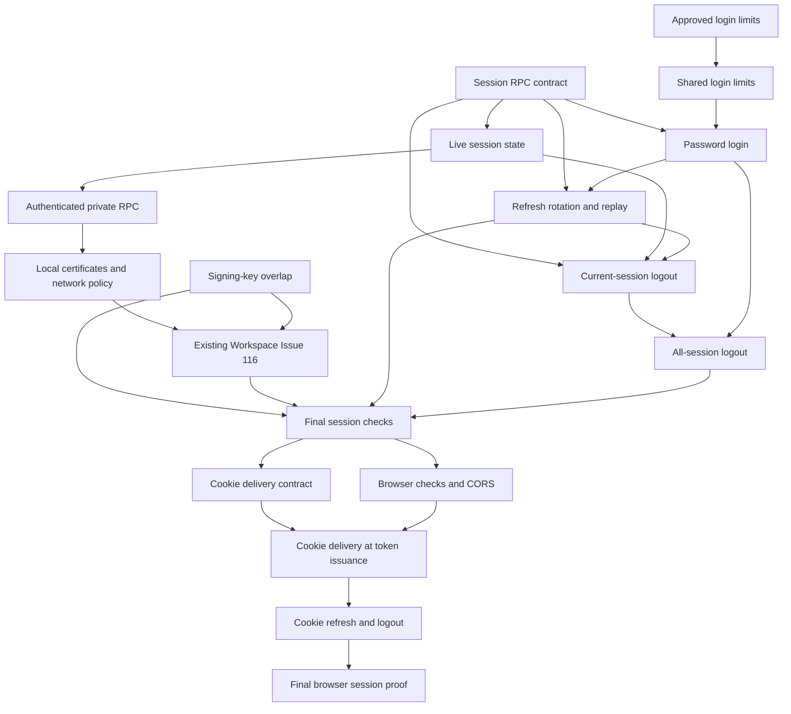

# Implementation plan: Identity password login and sessions

Module ID: `identity-password-login-and-sessions`

Status: Approved

## Overview

Add password login, refresh, logout, signing-key overlap, and live session checks to the existing Identity service. Signup and account claim already issue the first session and token pair. This plan extends that shared session life cycle.

Phases 6 and 7 add browser sessions. A browser client receives the refresh token in a `__Host-flowspace-refresh` HttpOnly cookie, refreshes from it after a reload, and clears it at logout. Identity checks the exact `Origin` and the content type of each request that uses the cookie, and it answers CORS requests only for the configured frontend origins.

The plan follows the approved [Identity password login and sessions](../docs/specs/identity-password-login-and-sessions.md) specification.

## Architecture decisions

- Reuse Identity's existing Ed25519 signer, session issuance, account lookup, trusted source-address handling, PostgreSQL limit store, and JWKS route. [ADR-0035](../docs/adr/0035-identity-signup-security-and-mail-delivery.md) fixes token validation, the JWKS cache bound, and key rotation; these choices do not need another approval.
- The approved specification allows 60 password-login attempts per trusted source address in a rolling hour. It also allows 10 attempts per normalized email identifier in a rolling 15 minutes. Both limits count unknown accounts and successful logins. Identity rejects a full limit before hashing and fails closed when the shared limit store is unavailable.
- Keep the five session RPCs in `flowspace.identity.v1`. Only the four client operations get REST routes. `CheckSession` has no public REST route, and the public gRPC listener rejects a direct call.
- Read current account and session state in Identity for every `CheckSession`. The caller first validates the access token locally and passes its subject and session ID. Identity returns the current email-verification state, never a Workspace role.
- Serve `CheckSession` on a separate TLS 1.3 gRPC listener. Authenticate callers with the CA, URI subject alternative name, and public-key fingerprint allowlist in [ADR-0036](../docs/adr/0036-authenticate-internal-session-checks-with-mutual-tls.md). Keep health and JWKS on their existing listener.
- Keep only hashes of current and rotated refresh tokens. A transaction consumes the current token once; reuse of a known rotated token revokes that device session. Login, refresh, and logout use the same session expiry and revocation rules as signup and claim.
- Record login, refresh, replay, logout, session-check failure, and Identity-unavailable outcomes without credentials, tokens, full email addresses, or high-cardinality metric labels.
- Deliver the refresh token in the body or in the cookie from 1 shared step of token issuance, so that `CreateAccount`, `ClaimUnverifiedAccount`, `CreatePasswordSession`, `CreateProviderSession`, and `RefreshSession` follow the same rule, as [ADR-0052](../docs/adr/0052-browser-sessions-keep-the-refresh-token-in-an-httponly-cookie.md) states. The cookie needs no new table, because Identity stores the same refresh-token hash. `CompleteMfaLogin` and the delivery choice of an MFA challenge belong to the plan of the `identity-mfa-login` module.
- Put the CORS answers and the `application/json` rule for each public REST `POST` route in the public HTTP adapter, before the gateway. The gateway passes the `Origin`, `Content-Type`, and `Cookie` headers to the handlers as metadata. Each handler that selects cookie delivery or reads a cookie runs the browser checks before any other work, and it sets or clears a cookie through response metadata that the adapter turns into `Set-Cookie`. The adapter marks each request that comes through the gateway, and the handlers read browser metadata only from a marked request. A native gRPC request on the public port then fails the browser checks, also when it sends gateway metadata keys itself.
- Read `ALLOWED_ORIGINS` once at startup, and stop the process on a malformed entry. Set the local frontend origin in the local cluster configuration. The staging and production hostnames stay open until the deployment decides them.
- Reuse [Issue #116](https://github.com/vasapolrittideah/flowspace-api/issues/116) for Workspace's local token validation, authenticated `CheckSession` client, and verified-email gate. This plan does not create a second Workspace admission task. [Issue #117](https://github.com/vasapolrittideah/flowspace-api/issues/117) remains the signup capability's final test task.

## Dependency graph

## Task list

Tasks are tracked in the [flowspace-api](https://github.com/users/vasapolrittideah/projects/4) GitHub Project under the [Identity password login and sessions](https://github.com/vasapolrittideah/flowspace-api/milestone/2) milestone.

### Phase 1: Decisions and contract

- Task 1: [#155 Set numeric password-login limits](https://github.com/vasapolrittideah/flowspace-api/issues/155). [PR #167](https://github.com/vasapolrittideah/flowspace-api/pull/167) recorded the approved numbers. Issue #155 also tracks enforcement in Task 7 and use before hashing in Task 8.
- Task 2: [#156 Define public session and internal CheckSession contracts](https://github.com/vasapolrittideah/flowspace-api/issues/156)

### Checkpoint: Decisions and contract

- [x] The numeric limits are approved in the specification before login code depends on them.
- [x] Buf accepts the public routes and the internal RPC, with no REST route for `CheckSession`.

### Phase 2: Live session checks

- Task 3: [#157 Return current Identity session state](https://github.com/vasapolrittideah/flowspace-api/issues/157)
- Task 4: [#158 Authenticate the private CheckSession RPC](https://github.com/vasapolrittideah/flowspace-api/issues/158)
- Task 5: [#159 Deploy the private Identity listener in the local cluster](https://github.com/vasapolrittideah/flowspace-api/issues/159)

### Checkpoint: Live session checks

- [x] Identity rejects a wrong subject, revoked or expired session, and retired account. A verified-email change appears on the next check.
- [x] Missing or unapproved client certificates fail, and the public gRPC path rejects `CheckSession`.
- [x] The local Service and NetworkPolicy expose the private listener only to approved callers. Issue #116 can use it without another Identity session-check path.

### Phase 3: Signing keys and password login

- Task 6: [#160 Publish signing keys through routine rotation](https://github.com/vasapolrittideah/flowspace-api/issues/160)
- Task 7: [#161 Enforce shared password-login limits](https://github.com/vasapolrittideah/flowspace-api/issues/161)
- Task 8: [#162 Create password sessions with generic failures](https://github.com/vasapolrittideah/flowspace-api/issues/162)

### Checkpoint: Signing keys and password login

- [x] Old and new key IDs work during the approved overlap, and a retired key stops working after its last valid token expires.
- [x] A known account receives one new session and token pair. Unknown, retired, and wrong-password requests have the same safe result.
- [x] Source and email limits run before password hashing, and a limit-store outage denies login.

### Phase 4: Refresh and logout

- Task 9: [#163 Rotate refresh tokens and revoke on replay](https://github.com/vasapolrittideah/flowspace-api/issues/163)
- Task 10: [#164 Revoke the current session on logout](https://github.com/vasapolrittideah/flowspace-api/issues/164)
- Task 11: [#165 Revoke all sessions for a subject](https://github.com/vasapolrittideah/flowspace-api/issues/165)

### Checkpoint: Refresh and logout

- [x] Concurrent refreshes cannot both succeed. Reusing a known old token revokes only its device session.
- [x] Current-session logout stops later checks for that session, while another device stays active.
- [x] All-session logout revokes sessions committed before it and permits a new login committed afterward.

### Phase 5: Completion checks

- Task 12: [#166 Prove public, private, and failure paths](https://github.com/vasapolrittideah/flowspace-api/issues/166). [PR #189](https://github.com/vasapolrittideah/flowspace-api/pull/189) records the final verification.

### Checkpoint: Completion checks

- [x] Public REST and typed RPC tests cover every applicable specification success criterion and threat ID.
- [x] Workspace Issue #116 proves local access-token validation, the live check, verified-email admission, and fail-closed behavior. The signup capability keeps its own final checks in Issue #117.
- [x] Generated output matches source contracts and queries. Required repository checks pass without weaker settings, and the review diff contains no unrelated changes or secrets.

### Phase 6: Browser sessions

- Task 13: [#554 Define the refresh-token cookie delivery contract](https://github.com/vasapolrittideah/flowspace-api/issues/554)
- Task 14: [#555 Check browser origins, content types, and CORS on public Identity routes](https://github.com/vasapolrittideah/flowspace-api/issues/555)
- Task 15: [#556 Deliver the refresh token in a cookie when Identity issues a session](https://github.com/vasapolrittideah/flowspace-api/issues/556)
- Task 16: [#557 Refresh a session from the cookie and clear the cookie at logout](https://github.com/vasapolrittideah/flowspace-api/issues/557)

### Checkpoint: Browser sessions

- [ ] Each token-issuance RPC and `RefreshSession` accept `use_refresh_token_cookie`, the `refresh_token` field of `RefreshSessionRequest` is optional, and generated output matches the source Protobuf.
- [ ] A request that uses the cookie fails with `PermissionDenied` for a wrong, missing, or `null` `Origin` or a content type other than `application/json`, and each public REST `POST` route rejects a non-JSON media type.
- [ ] Cookie delivery leaves `refresh_token` empty and sets the cookie with the required attributes, a cookie refresh rotates the token, and logout or a failed refresh clears the cookie.
- [ ] CORS answers allow only the origins in `ALLOWED_ORIGINS`, allow credentials, and send `Vary: Origin`.

### Phase 7: Browser completion checks

- Task 17: [#558 Prove Identity password login and sessions against its specification](https://github.com/vasapolrittideah/flowspace-api/issues/558)

### Checkpoint: Complete

- [ ] REST, PostgreSQL, CORS, cookie, telemetry, and Bruno smoke tests cover each success criterion and each threat ID of the specification, including criteria 16 to 20 and `ID-T23` to `ID-T26`.
- [ ] Required repository checks pass without weaker settings.

## Risks and controls

| Risk | Impact | Control |
| --- | --- | --- |
| A protected service accepts a signed but revoked token. | Logout cannot stop new requests. | Require local token validation followed by an uncached, successful `CheckSession` on every protected request; prove the Workspace path in Issue #116. |
| A public caller reaches `CheckSession` or a private caller presents another service's certificate. | The caller can probe account and session state. | Keep the public gRPC method disabled; verify TLS client identity, URI SAN, and pinned public-key fingerprint on the private listener. |
| Two refresh requests consume the same token. | A replay stays active or two token pairs become valid. | Serialize the token transition in PostgreSQL and revoke the device when the loser presents a known rotated hash. |
| All-session logout races with session creation. | An old session remains active after logout success. | Serialize both operations on the account row and test both commit orders. |
| A key disappears before its last access token expires. | Valid requests fail during routine rotation. | Publish the next public key before switching the signer; retain the old key for the ADR-0035 overlap and test its retirement. |
| Identity or the limit store is unavailable. | Protected requests or login may bypass checks. | Return service unavailability without admitting the request or skipping a limit. |
| A site on another origin makes the browser refresh or log in with the cookie. | An attacker uses or replaces the session of the victim. | Check the exact `Origin` and the content type before any work in Task 14, and test each failing case in Tasks 14 to 16. |
| A response sets the cookie with a wrong attribute or a `Domain`. | Another host reads or replaces the cookie. | Build the cookie in 1 place, and test each attribute in Task 15. |
| A cookie response puts the refresh token in the body. | An injected script reads a reusable credential. | Test that cookie delivery leaves `refresh_token` empty in Tasks 15 and 16. |
| A CORS answer allows a wrong origin or misses `Vary: Origin`. | Another site reads a credentialed response, or a cache serves it to another origin. | Compare origins byte for byte, and test allowed, similar, unknown, and `null` origins in Task 14. |
| The `Cookie` or `Set-Cookie` header reaches logs or traces. | A refresh token becomes reusable from telemetry. | Keep both headers out of the request logs and spans, and capture telemetry in Tasks 14 and 17. |
| A rollback to older code returns the refresh token in the body to a browser. | An injected script reads a reusable credential after the rollback. | State in the PR of Task 15 that the web frontend stops sending `use_refresh_token_cookie` before a rollback. |
| A non-JSON `POST` rule breaks an existing client. | An API client that sends no content type on an empty `POST` fails. | Update the Bruno requests in Task 14, and name the change under Breaking changes in its PR. |
