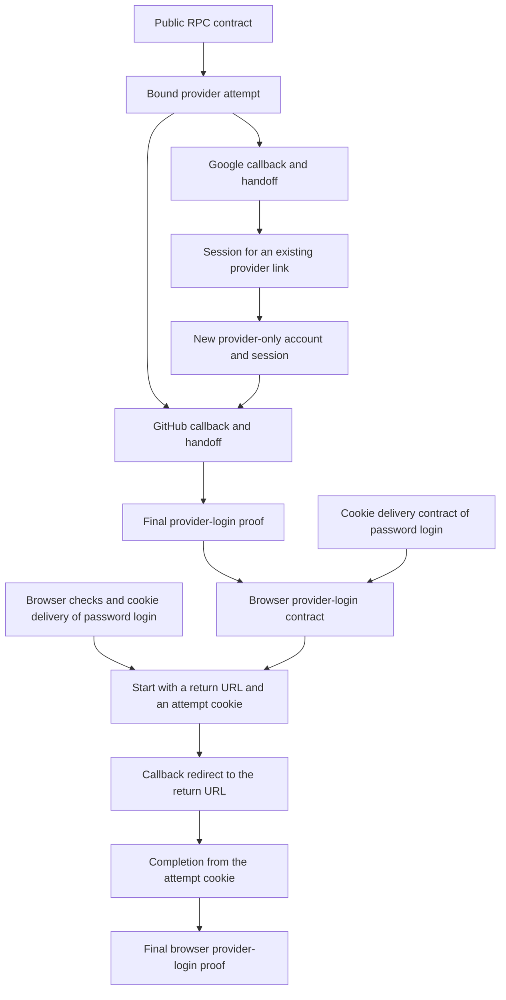

# Implementation plan: Identity provider login

Module ID: `identity-provider-login`

Status: Approved

## Overview

Add Google and GitHub login for API clients with the one-time browser handoff. Identity creates a session for a known provider link, or it creates a provider-only account when a new provider identity has an unused verified email. The first release uses disposable data.

Phases 4 and 5 add the browser redirect handoff. A browser start with a return URL keeps the attempt token in a `__Host-flowspace-login-attempt` cookie, the callback redirects to the return URL with the handoff code in the fragment, and the completion reads the attempt cookie and delivers the refresh token in a cookie.

The plan follows the approved [Identity provider login](../docs/specs/identity-provider-login.md) specification.

## Architecture decisions

- Add `StartProviderLogin` and `CreateProviderSession` to `flowspace.identity.v1` with generated REST routes. Keep the provider callback as the small HTTP adapter approved by [ADR-0034](../docs/adr/0034-provider-login-uses-a-one-time-handoff.md). The callback never issues Flowspace tokens.
- Store each short-lived attempt and its provider result in Identity PostgreSQL. Bind the provider, state, PKCE verifier, Google nonce, attempt token, and handoff code to one attempt. Store keyed verifiers for the two client proofs and consume each transition once.
- Verify Google ID tokens and GitHub user identity through separate provider adapters. Use the provider name and stable provider subject as the link key. Do not identify a returning user or link a password account by email alone.
- Extend Identity's account schema to allow a provider-only account without a password hash. Add a unique provider-link record. Reuse the existing session, email-challenge, outbox, trusted source-address, and shared limit paths.
- Store the return URL with the attempt in a new nullable column, and keep attempts without a return URL on the callback page. Read `PROVIDER_RETURN_URLS` once at startup, and stop the process when an entry has a fragment or an origin outside `ALLOWED_ORIGINS`, as [ADR-0053](../docs/adr/0053-browser-provider-flows-redirect-the-handoff-code-to-the-frontend.md) states.
- Reuse the browser checks, the cookie helpers, and the cookie delivery of the `identity-password-login-and-sessions` plan. Its [#556](https://github.com/vasapolrittideah/flowspace-api/issues/556) delivers the refresh token in a cookie for a `CreateProviderSession` request with an attempt token and `use_refresh_token_cookie=true`. The attempt cookie of each purpose uses the same helpers with its own name, so that the re-authentication and link plans reuse them.
- Keep collision and missing-email responses alike. Issue a session to a new unverified account, but keep Workspace's verified-email gate until Flowspace verifies that email. Apply the existing session lifetimes to provider sessions.

## Dependency graph

## Task list

Tasks are tracked in the [flowspace-api](https://github.com/users/vasapolrittideah/projects/4) GitHub Project under the [Identity provider login](https://github.com/vasapolrittideah/flowspace-api/milestone/5) milestone.

### Phase 1: Contract and browser handoff

- Task 1: [#215 Define the public provider-login contract](https://github.com/vasapolrittideah/flowspace-api/issues/215)
- Task 2: [#216 Start a bound provider attempt with shared limits](https://github.com/vasapolrittideah/flowspace-api/issues/216)
- Task 3: [#217 Validate a Google callback and issue a one-time handoff code](https://github.com/vasapolrittideah/flowspace-api/issues/217)

### Checkpoint: Contract and browser handoff

- [x] Both RPC routes and the Google callback route match the approved contract, and generated output matches the source Protobuf.
- [x] Google callback tests reject altered or replayed proof and show one handoff code without a Flowspace token.
- [x] Attempt expiry, start and callback limits, safe errors, and secret-free callback content pass focused tests.

### Phase 2: Provider sessions and accounts

- Task 4: [#218 Create a session for an existing provider link](https://github.com/vasapolrittideah/flowspace-api/issues/218)
- Task 5: [#219 Create a provider-only account and session from an unused Google email](https://github.com/vasapolrittideah/flowspace-api/issues/219)

### Checkpoint: Provider sessions and accounts

- [x] A linked Google identity returns to the same subject even when its provider email changes or is absent.
- [x] A new Google identity creates one account, link, and session; Gmail and Google Workspace email rules set the correct Flowspace verification state.
- [x] A new account with a verified third-party Google email receives a Flowspace verification code, and Workspace denies access until that code is used.
- [x] Email collisions, missing proof, concurrent claims, and lost responses leave no duplicate account or replayed token.

### Phase 3: GitHub login and completion checks

- Task 6: [#220 Complete provider login with GitHub identity and email proof](https://github.com/vasapolrittideah/flowspace-api/issues/220)
- Task 7: [#221 Prove Identity provider login against its specification](https://github.com/vasapolrittideah/flowspace-api/issues/221). [PR #266](https://github.com/vasapolrittideah/flowspace-api/pull/266) records the final verification.

### Checkpoint: GitHub login and completion checks

- [x] Google and GitHub REST, callback, PostgreSQL, Mailpit, concurrency, failure, limit, telemetry, and cross-service tests cover the specification and applicable threat IDs.
- [x] The final Issue result comment records results, gaps, and the review PR. Required repository checks pass without weaker settings.

### Phase 4: Browser redirect handoff

- Task 8: [#559 Define the browser provider-login contract](https://github.com/vasapolrittideah/flowspace-api/issues/559)
- Task 9: [#560 Start a provider login with a return URL and an attempt cookie](https://github.com/vasapolrittideah/flowspace-api/issues/560)
- Task 10: [#561 Redirect the provider callback to the return URL with the handoff code](https://github.com/vasapolrittideah/flowspace-api/issues/561)
- Task 11: [#562 Complete a provider login from the attempt cookie](https://github.com/vasapolrittideah/flowspace-api/issues/562)

### Checkpoint: Browser redirect handoff

- [ ] `StartProviderLogin` accepts `return_url`, `CreateProviderSession` accepts `use_refresh_token_cookie` and an empty `attempt_token`, and generated output matches the source Protobuf.
- [ ] A return URL that differs from each configured entry by any byte returns `InvalidArgument`, and an accepted one sets the attempt cookie and leaves `attempt_token` empty.
- [ ] The callback answers HTTP 303 with `#handoff_code=` or `#error=`, `no-store`, and `no-referrer`, and it shows the page when it cannot find the attempt.
- [ ] A cookie completion issues a session with cookie delivery, clears the attempt cookie after an ending failure, and keeps it after a failure that leaves the attempt usable.

### Phase 5: Browser completion checks

- Task 12: [#563 Prove Identity provider login against its specification](https://github.com/vasapolrittideah/flowspace-api/issues/563)

### Checkpoint: Complete

- [ ] REST, callback, PostgreSQL, cookie, telemetry, and Bruno smoke tests cover each success criterion and each threat ID of the specification, including criteria 15 to 19 and `ID-T23`, `ID-T24`, `ID-T26`, and `ID-T27`.
- [ ] Required repository checks pass without weaker settings.

## Risks and controls

| Risk | Impact | Control |
| --- | --- | --- |
| A forged, mixed, or replayed callback claims another login attempt. | An attacker gains a Flowspace session. | Bind state, provider, PKCE, nonce, attempt token, and handoff code to one expiring attempt; test wrong and concurrent submissions. |
| An email match links a provider to a password account. | An attacker takes over another subject. | Use a unique provider subject link and reject an unlinked identity when its email belongs to an existing account. |
| Provider claims or email responses are incomplete or forged. | Identity creates a session for the wrong person. | Verify Google signatures and claims; fetch GitHub's authenticated user ID and primary verified email for a new identity. |
| A provider-only account bypasses email verification. | An unverified user reaches Workspace. | Apply the approved Google email rules and reuse the Flowspace challenge and live session gate. |
| A database, provider, or email delivery failure leaves partial state. | An account, link, or session exists without the required proof or delivery record. | Commit account, link, session, and any email challenge with its outbox record together; retry delivery only after commit. |
| A return URL check accepts a URL by prefix, case, or normalization. | The handoff code goes to a page that the frontend does not own. | Compare byte for byte with the configured list, and test URLs that differ by 1 byte, case, a trailing slash, encoding, and a fragment in Task 9. |
| The handoff code leaves the fragment, or the redirect lacks `no-store` or `no-referrer`. | The code reaches logs, caches, or `Referer` headers. | Test the redirect headers and the `Location` value in Task 10, and keep `Location` out of telemetry. |
| A handoff code completes without its attempt cookie, or with a cookie of another purpose. | A crafted link signs a victim in to the account of an attacker. | Read only the login attempt cookie in `CreateProviderSession`, and test a missing and a wrong-purpose cookie in Task 11. |
| The attempt cookie stays after an ending failure, or is cleared after a failure that leaves the attempt usable. | A stale cookie confuses the next attempt, or a user loses a usable attempt. | Test each failure kind in Task 11. |
| A rollback leaves pending browser attempts. | Older code shows the callback page, and the browser cannot complete the attempt. | Document in Task 9 that the frontend stops sending `return_url` before a rollback, and that the pending attempts expire within 10 minutes. |
| Secrets appear in callbacks, redirects, or telemetry. | A token or code can be reused. | Keep provider tokens server-side, render only the handoff code on the callback page, and capture browser output and telemetry in tests. |
