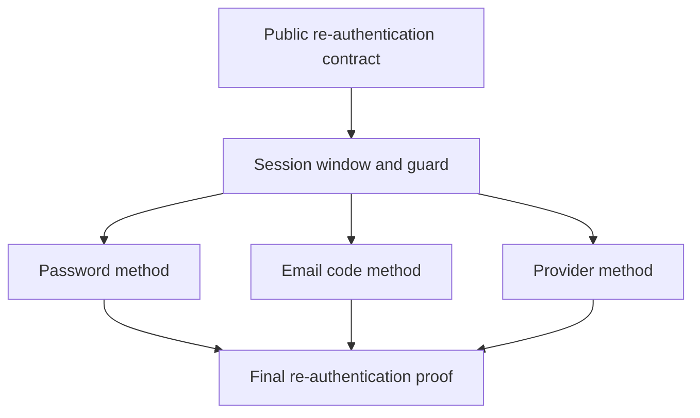

# Implementation plan: Identity re-authentication

Module ID: `identity-re-authentication`

Status: Approved

## Overview

Let a signed-in session prove its owner again with a password, an email code, or a linked provider, and open a 10-minute re-authentication window. Each new session starts with an open window, and a guard lets a later sensitive method refuse a session whose window is closed. No public sensitive method exists in this module.

The plan follows the approved [Identity re-authentication](../docs/specs/identity-re-authentication.md) specification.

## Architecture decisions

- Add the 5 re-authentication RPCs to `flowspace.identity.v1` with generated REST routes in 1 contract task, before any behavior.
- Store 1 nullable re-authentication time on each session. Keep the window guard in the application layer so that each later sensitive method calls it in its own transaction. A test-only method proves the guard, as the specification requires.
- Reuse the existing limit buckets of password login, email codes, and provider login. Add no new limit table.
- Reuse the provider attempts, the callback route, and the handoff of [ADR-0034](../docs/adr/0034-provider-login-uses-a-one-time-handoff.md). Add a purpose, a subject, and a session ID to each attempt, as [ADR-0045](../docs/adr/0045-provider-re-authentication-reuses-the-one-time-handoff.md) states.

## Dependency graph

## Task list

Tasks are tracked in the [flowspace-api](https://github.com/users/vasapolrittideah/projects/4) GitHub Project under the [Identity re-authentication](https://github.com/vasapolrittideah/flowspace-api/milestone/9) milestone.

### Phase 1: Contract and window

- Task 1: [#508 Define the public re-authentication contract](https://github.com/vasapolrittideah/flowspace-api/issues/508)
- Task 2: [#509 Open a re-authentication window at login and guard sensitive methods](https://github.com/vasapolrittideah/flowspace-api/issues/509)

### Checkpoint: Contract and window

- [x] The 5 RPC routes match the approved contract, and generated output matches the source Protobuf.
- [x] A new session from signup, account claim, password login, or provider login has an open window that closes after 10 minutes and that a refresh does not extend.
- [x] The test-only sensitive method returns `PermissionDenied` with the reason `REAUTHENTICATION_REQUIRED` outside the window.

### Phase 2: Re-authentication methods

- Task 3: [#510 Re-authenticate a session with the account password](https://github.com/vasapolrittideah/flowspace-api/issues/510)
- Task 4: [#511 Re-authenticate a session with an email code](https://github.com/vasapolrittideah/flowspace-api/issues/511)
- Task 5: [#512 Re-authenticate a session with a linked provider](https://github.com/vasapolrittideah/flowspace-api/issues/512)

### Checkpoint: Re-authentication methods

- [x] Each method opens the window of the current session only and keeps the end time while the window is open.
- [x] Each method counts against the shared limits of its kind and fails closed when the limit store is unavailable.
- [x] A code or a provider result of another purpose cannot open the window, and a re-authentication code cannot claim, reset, or verify.

### Phase 3: Completion checks

- Task 6: [#513 Prove Identity re-authentication against its specification](https://github.com/vasapolrittideah/flowspace-api/issues/513)

### Checkpoint: Complete

- [ ] REST, PostgreSQL, Mailpit, callback, concurrency, failure, limit, telemetry, and Bruno smoke tests cover the success criteria and threat IDs of the specification.
- [ ] Required repository checks pass without weaker settings.

## Risks and controls

| Risk | Impact | Control |
| --- | --- | --- |
| The guard admits a change after the window ends in a race with its check. | A stolen session makes a sensitive change without proof. | Make sure that the window is open in the transaction of the change. Test the race through the test-only method in Task 2. |
| A re-authentication opens the window of another session of the subject. | A session on another device skips the proof. | Bind the window to the session of the access token. Test 2 sessions in Tasks 2 to 5. |
| A code or a provider result of another purpose opens the window. | A verification, claim, reset, or login result becomes a step-up proof. | Bind each challenge and attempt to its purpose. Test cross-purpose use in Tasks 4 and 5. |
| Re-authentication bypasses the shared limits. | An attacker guesses passwords or codes through a second path. | Count each method in the existing buckets. Test the limits across replicas in Tasks 3 to 5. |
| A rollback lets older code complete a re-authentication attempt as provider login. | A provider result creates an unexpected session. | Document the deletion of pending re-authentication attempts before a rollback in Task 5. |
| A dependency failure, a timeout, or a cancellation opens a window. | A session gets a window without a committed proof. | Return a result only after the commit. Test failures and cancellations in Tasks 3 to 6. |
| An expiry, a refresh, or a retry extends a window. | A session keeps the window longer than 10 minutes. | Test the boundary, the refresh, and the open-window retry with a controlled clock in Tasks 2 to 6. |
| Telemetry or errors contain a password, a code, or a token. | A secret becomes reusable. | Capture logs, traces, and errors in tests of each method and in Task 6. |
