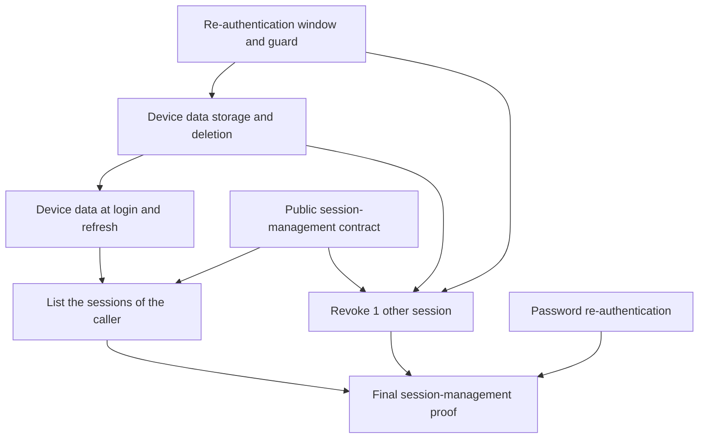

# Implementation plan: Identity session management

Module ID: `identity-session-management`

Status: Approved

## Overview

Let a signed-in user list the active sessions of their account with the device data of each session, and revoke 1 other session. Identity records the sign-in method, the trusted IP address, and the user agent of each session, and it deletes them when the session ends or expires.

The plan follows the approved [Identity session management](../docs/specs/identity-session-management.md) specification.

## Architecture decisions

- Add `ListSessions` and `RevokeSession` to `flowspace.identity.v1` with generated REST routes in 1 contract task, before any behavior.
- Store the device data as columns of each session row. Do not add a separate table, because the data lives and ends with the session.
- Put the user-agent parser and the 512-byte cut in the domain layer, so that every login path and refresh uses 1 rule.
- Add the storage and the deletion of device data in 1 task before any login records it, so that no release keeps device data longer than the specification allows. `identity-worker` deletes the data of expired sessions.
- `RevokeSession` uses the window guard of the [Identity re-authentication](identity-re-authentication.md) plan, so the revoke task waits for that guard. The final Prove task waits for password re-authentication of that plan, because its smoke test opens the window with it.

## Dependency graph

## Task list

Tasks are tracked in the [flowspace-api](https://github.com/users/vasapolrittideah/projects/4) GitHub Project under the [Identity session management](https://github.com/vasapolrittideah/flowspace-api/milestone/10) milestone.

### Phase 1: Contract and device data

- Task 1: [#515 Define the public session-management contract](https://github.com/vasapolrittideah/flowspace-api/issues/515)
- Task 2: [#516 Store device data and delete it at revocation and expiry](https://github.com/vasapolrittideah/flowspace-api/issues/516)
- Task 3: [#517 Record device data at login and refresh](https://github.com/vasapolrittideah/flowspace-api/issues/517)

### Checkpoint: Contract and device data

- [ ] Both RPC routes match the approved contract, and generated output matches the source Protobuf.
- [ ] Every revocation path and the expiry cleanup delete the device data within the stated time, before any login records it.
- [ ] Each new session has the sign-in method, the trusted IP address, the cut user agent, and the device label, and a refresh updates only the last-used values.

### Phase 2: List and revoke

- Task 4: [#518 List the active sessions of the caller](https://github.com/vasapolrittideah/flowspace-api/issues/518)
- Task 5: [#519 Revoke 1 other session of the caller](https://github.com/vasapolrittideah/flowspace-api/issues/519)

### Checkpoint: List and revoke

- [ ] `ListSessions` returns only active sessions of the caller in the stated order, with pages that work only for the caller.
- [ ] `RevokeSession` needs an open window, rejects the current session, and gives the same `NotFound` result for another subject and an unknown ID.
- [ ] A revoked session cannot refresh or pass `CheckSession` after the commit, and a racing refresh cannot commit after it.

### Phase 3: Completion checks

- Task 6: [#520 Prove Identity session management against its specification](https://github.com/vasapolrittideah/flowspace-api/issues/520)

### Checkpoint: Complete

- [ ] REST, PostgreSQL, concurrency, failure, telemetry, and Bruno smoke tests cover the success criteria and threat IDs of the specification.
- [ ] Required repository checks pass without weaker settings.

## Risks and controls

| Risk | Impact | Control |
| --- | --- | --- |
| An IP address from an untrusted header reaches the device data. | A client spoofs the address that the owner reads. | Reuse the trusted source-address path of password login. Test untrusted headers in Task 3. |
| A long or hostile user agent breaks a request or the parser. | A login fails, or a request uses too much CPU. | Cut the value at 512 bytes before parsing. Test hostile values in Task 3. |
| A revocation path leaves device data stored. | Personal data stays after its purpose. | Delete the data through 1 shared step before any login records it. Test every revocation path and the expiry bound in Task 2. |
| A session of another subject appears in the list, or its revocation gives a different result. | A user learns about or ends a session of another person. | Filter by the subject of the access token. Test another subject and an unknown ID in Tasks 4 and 5. |
| A refresh of the target session commits after its revocation. | A revoked session keeps a working token pair. | Serialize the revocation with the refresh. Test the race in Task 5. |
| Telemetry contains an IP address, a user agent, or a token. | Personal data or a secret leaks. | Capture logs, traces, and errors in Tasks 2 to 6. |
